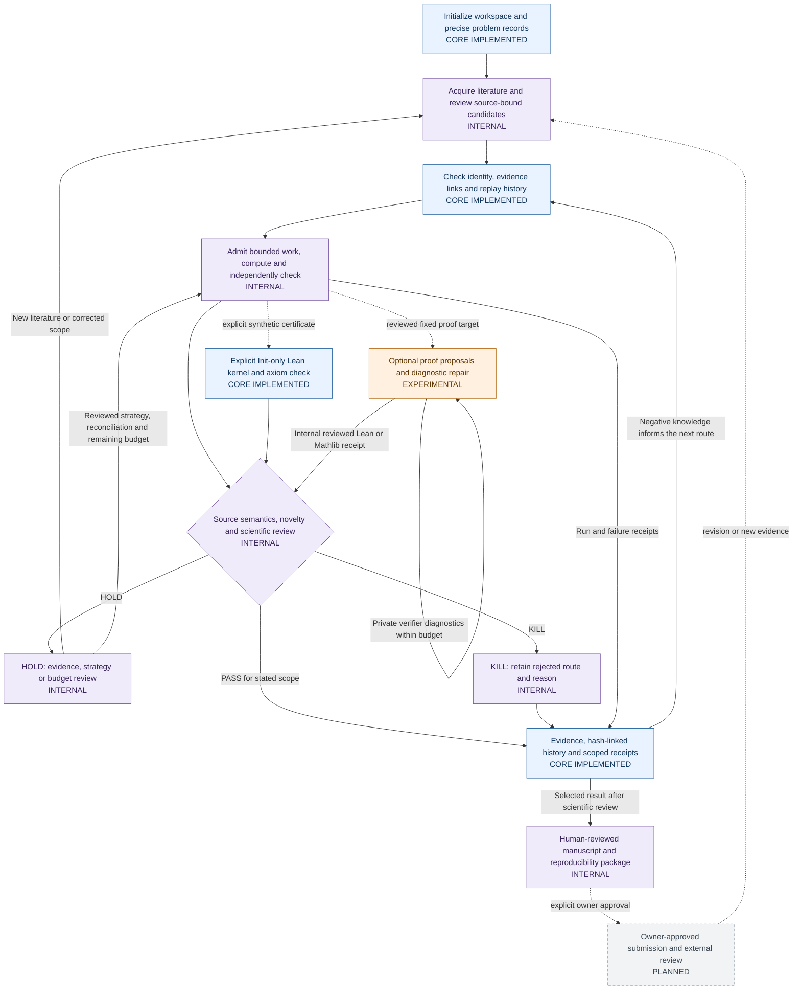

<p align="center">
  
</p>

<div align="center">

  # MathForge

  **Forge mathematical ideas. Verify the evidence.**

  A research-oriented framework for structured mathematical exploration, verification gates, and reproducible evidence.

  [](#development-status)
  [](#license-and-provenance)
  [](https://github.com/RanchoTao/MathForge/actions/workflows/ci.yml)

  **[Overview](#what-is-mathforge) · [Research workflow](#research-workflow) · [Current status](#development-status) · [Roadmap](#roadmap) · [Architecture](docs/architecture/SYSTEM_ARCHITECTURE.md) · [Release checklist](docs/PUBLIC_RELEASE_CHECKLIST.md) · [中文简介](#中文简介)**
</div>

---

## What is MathForge?

Mathematical research is not just the production of plausible proofs. It is a cycle of **forming precise claims, exploring possible arguments or counterexamples, checking those claims independently, and preserving enough evidence for others to scrutinize the result**.

MathForge is being developed around that cycle. Its long-term goal is a modular, auditable environment in which human researchers, language models, computational tools, and formal proof assistants can participate in mathematical investigation **without confusing generated hypotheses with established results**.

The distinguishing design priority is **evidence before announcement**: a promising candidate should remain a candidate until the required verification and review have been completed.

> **Scope notice:** This repository is currently a private, pre-release project. As of October 20, 2026, it contains the brand assets, license text, project documentation and the reviewed synthetic CORE source and CI workflow merged through [PR #1](https://github.com/RanchoTao/MathForge/pull/1). The full autonomous research system is not being represented as a publicly runnable product. **Apache-2.0 has been selected for a future public Core release, but rights clearance is still pending; see the [release checklist](docs/PUBLIC_RELEASE_CHECKLIST.md).**

## Research workflow

### MathForge Research Workflow

This is a research lifecycle with feedback, not a deployment diagram. **CORE IMPLEMENTED** means included in this distribution; **INTERNAL** means private code or supervised research records; **EXPERIMENTAL** means partial qualification; **PLANNED** means a future or external step. Solid arrows show workflow handoffs; dashed arrows show optional or future paths. No public CORE command launches private research workers. The detailed map distinguishes actual computation, reviewed decisions and future automation.



A **PASS** is a gate decision supported by its defined checks, **not** an automatic assertion of novelty, a completed formalization, peer-review acceptance, or publication. A **HOLD** preserves uncertainty; a **KILL** records why a claim or route should stop. Scientific conclusions require domain-specific standards and review.

Read the [full end-to-end lifecycle](docs/architecture/FULL_RESEARCH_WORKFLOW.md), [module and data-flow architecture](docs/architecture/SYSTEM_ARCHITECTURE.md), [scientific gates and recovery loops](docs/architecture/RESEARCH_LIFECYCLE.md), [CORE versus internal capability matrix](docs/architecture/CORE_VS_INTERNAL.md), and [node-to-code evidence](docs/architecture/WORKFLOW_EVIDENCE.md).

### Design principles

| Principle | Meaning |
| --- | --- |
| **Traceability** | Keep track of the candidate, inputs, checks, and supporting records behind each decision. |
| **Independent verification** | Separate proposing a claim from determining whether the claim has been substantiated. |
| **Explicit gates** | Make rejection, uncertainty, and evidence requirements visible rather than silently promoting drafts. |
| **Reproducibility** | Prefer inspectable procedures, recorded artifacts, and testable interfaces to opaque success narratives. |
| **Human accountability** | Reserve scientific interpretation, authorship, and publication decisions for responsible researchers. |

## Development status

MathForge has **two different scopes**: an internal research workspace, and a deliberately smaller Core intended for independent use and eventual open-source distribution. They are not equivalent.

| Area | Verified or current state | Boundary |
| --- | --- | --- |
| **Repository contents** | Reviewed synthetic CORE source, tests and CI merged in PR #1; initialization history, brand assets and license text preserved. | Private repository; public distribution remains HOLD. |
| **Extracted Core candidate** | 58 files, approximately 205 KB, assembled from a reviewed subset of the original engineering workspace. | Extraction baseline only; repository totals also include existing images and integration documents. |
| **Schemas, scientific contracts, state graph** | Included in the imported CORE; research/proof acceptance stays disabled. | Public APIs and compatibility guarantees are not finalized. |
| **Audit queue, replay, resource adapters, Inspector** | Imported CORE exercised locally and in cloud CI. | These are framework mechanisms, not evidence of autonomous research success. |
| **Lean integration** | A synthetic positive check and invalid-type rejection passed using the real Lean kernel. | This does **not** establish formal proofs of the private research claims. |
| **Autonomous discovery and paper production** | Long-term research direction; additional internal components and experiments are outside this repository. | No claim of independently verified end-to-end discovery performance. |
| **Cloud CI and installation** | Initial import and concurrent README integration passed Windows GitHub Actions. | 29 cloud cases, one explicit real-Lean skip; real Lean positive/negative checks passed locally. No public package publication. |

The architecture documents label every process node **CORE IMPLEMENTED**, **INTERNAL**, **EXPERIMENTAL** or **PLANNED**. A module appearing on a diagram is not, by itself, a verified product capability.

## Local validation

The extracted candidate was audited locally on October 20, 2026. The recorded checks included:

- installation into a fresh isolated Python environment and installation of a built wheel;
- **29 passing unit and adversarial tests**;
- synthetic Lean kernel acceptance and rejection checks;
- state and structure validation, persisted audit queue, export, replay, and package checks;
- ZIP integrity and file hash verification;
- confirmation that the original tracked research files were not rewritten.

Earlier validation attempts exposed a SQLite connection-lifetime issue, a Lean timeout, and a Python import-shadowing issue. Those were corrected and the final candidate was retested. These local results are distinct from the subsequent [successful import CI](https://github.com/RanchoTao/MathForge/actions/runs/39390367448). Cloud CI executes 29 tests with one explicitly optional real-Lean test skipped. Neither result is a scientific discovery benchmark.

## Getting started

The imported candidate supports Windows x64 / CPython 3.13.9. The demo creates synthetic data and executes validation and export only; it produces no research results.

```powershell
python -m venv .venv
.venv\Scripts\python -m pip install --require-hashes -r requirements-build.lock
.venv\Scripts\python -m pip install --require-hashes -r requirements.lock
.venv\Scripts\python -m pip install --no-deps --no-build-isolation .
.venv\Scripts\python scripts/mathforge.py validate
.venv\Scripts\python -m mathforge demo --output reports/local/demo001
.venv\Scripts\python -m unittest discover -s tests -v
```

Use a new output directory. See [installation](docs/INSTALL.md), [candidate architecture](docs/ARCHITECTURE.md), the [license review notice](docs/legal/LICENSE_REVIEW_NOTICE.txt), and the [public release checklist](docs/PUBLIC_RELEASE_CHECKLIST.md). GitHub Actions passed on both the initial import and the integrated README commit before PR #1 was merged. The optional real Lean integration was exercised locally and is skipped by cloud CI unless an explicit reviewed toolchain is supplied.

`CURRENT_FILE_MANIFEST.json` lists the current distributed file hashes (excluding itself). `FILE_MANIFEST.json` is the immutable 58-file pre-import candidate baseline (57 entries plus itself). `IMPORT_PROVENANCE.json` records the initial import mapping and hashes, including its README merge and relocated license review notice. Subsequent documentation updates do not rewrite that historical baseline. Original research history and private audit/validation files are excluded.

## Repository and research boundaries

The intended open-source release is a **clean, reusable Core**, not a mirror of the internal research environment. The original engineering inventory was roughly 94.7 MB and contained substantial third-party mathematical source material. The smaller public candidate deliberately excludes original research states, papers, private results, system-specific configuration, cached environments, and historical Git objects.

Publication of framework code should not be construed as:

- a release of unpublished mathematical results or private evidence;
- permission to redistribute unrelated third-party code or data;
- proof that an automatically generated claim is correct or novel;
- a guarantee that future experimental modules or hosted services will be released.

## Roadmap

| Stage | Goal |
| --- | --- |
| **01 · Foundation — complete** | Reviewed private CORE import, clean installation and successful GitHub CI. |
| **02 · Documentation — this update** | Implementation-grounded lifecycle, data flow, gate/recovery loops, evidence matrix and synthetic install guide. |
| **03 · Research tooling** | Improve tool adapters, evidence handling, formal-verification workflows, and clearly defined scientific gates. |
| **04 · Evaluation** | Compare research workflows under controlled budgets, including failure analysis, independent validation, and ablations. |
| **05 · Research dissemination** | Release reviewed case studies and methodological papers only when their correctness, provenance, and scientific contributions are substantiated. |

The roadmap is an intention, not a delivery schedule or a claim of completed scientific work.

## Contributions and responsible use

MathForge is at a pre-release stage. After the public source is available, contributions should prioritize reproducible bug reports, tests, documentation, validation adapters, and clearly scoped improvements. Research submissions should identify assumptions, provenance, verification limits, and remaining uncertainty.

If you use any automated mathematical research workflow, **do not present model-generated reasoning as an established theorem without independent checking**. Formal proof assistants check statements under their encoded assumptions; they do not automatically settle whether those statements faithfully capture an original scientific question.

## Research scope

MathForge combines evidence tracking, explicit scientific gates and reproducible verification interfaces. The long-term lifecycle includes literature, mathematical exploration, independent review and accountable dissemination. The current distributed CORE implements only the bounded infrastructure documented above. Unpublished research assets, private mathematical results and the internal executor are excluded.

---

## 中文简介

**MathForge** 是一个面向可验证数学研究的框架项目，目标是让数学问题描述、证据记录、研究状态、独立复核和形式化验证能够组成可追踪、可审计的工作流。

**目前已实现：** 私有 GitHub 仓库已导入经过审计的 Phase 0 Core，包含合成示例、状态与证据检查、持久审计队列、限定范围的 Lean 检查接口，以及相关测试和 CI。Core **不包含**完整的自主选题、全天候研究执行器、未发表论文或内部科研数据。详情见[全流程图](docs/architecture/FULL_RESEARCH_WORKFLOW.md)与[公开版/内部版能力对照](docs/architecture/CORE_VS_INTERNAL.md)。

**开源状态：** 已选定 Apache-2.0 作为计划发布许可证，但代码及品牌素材的权属授权和最终发布门禁仍待确认；目前不要将私有仓库 URL 当作可供外部访问的开源链接。

## License and provenance

The maintainer has **selected Apache License, Version 2.0** for the planned Core release. The [license text](./LICENSE) is already present, but the extracted package retains its pending-rights marker until applicable ownership, institutional or collaborator rights, third-party notices, and branding permissions are confirmed. The presence of a license file does **not** override that pending-authorization notice. See the [release checklist](docs/PUBLIC_RELEASE_CHECKLIST.md).

**MathForge · Research with evidence.**
